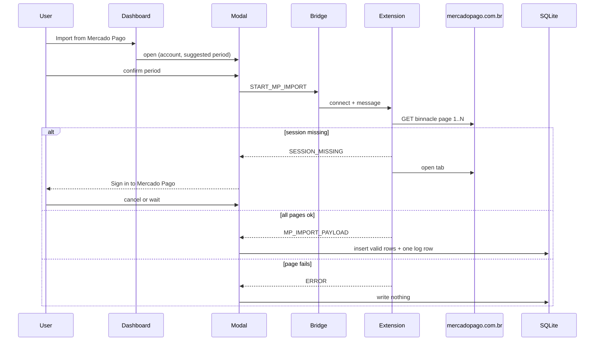

# Mercado Pago Import Design

**Spec**: `.specs/features/mercado-pago-import/spec.md`
**Status**: Approved (naming: `account_import_logs` + `source`)
**Issue**: https://github.com/juliano-pezzini/mytruetrack/issues/123

---

## Architecture Overview

Approach locked by issue 123: the companion extension holds the Mercado Pago browser session; the PWA validates rows and writes SQLite. Same shape as InvestPass, different origin and message type.



**Rejected alternatives (closed in the issue, not reopened):**

| Approach | Why not |
| --- | --- |
| Official Relatórios PDF/XLSX/CSV | Async generator; different product. |
| PWA `fetch` to Mercado Pago | Cookie and CORS stay on the Mercado Pago origin; the extension is the session holder. |
| Full COMPE bank list | Issue: Mercado Pago + Outros bancos only. |

---

## Code Reuse Analysis

### Existing Components to Leverage

| Component | Location | How to Use |
| --- | --- | --- |
| Import service | `src/workers/import-service.ts` | Dedup by `externalId`, validate via `createTransaction`, collect row errors. Extend to accept optional `importRunId`. |
| InvestPass bridge | `src/sync/investpass-bridge.ts` | Same `chrome.runtime.connect` port; widen the message union. Keep InvestPass `START_IMPORT`. |
| Extension background | `extension/src/background.ts` | Second handler branch for Mercado Pago; keep InvestPass path. |
| InvestPass date helper | `src/workers/investpass-import.ts` | Extract or copy `America/Sao_Paulo` calendar-day conversion. |
| Account repository | `src/storage/repositories/account-repository.ts` | Add `bank_code` read/write and uniqueness check for active `323`. |
| Transaction repository | `src/storage/repositories/transaction-repository.ts` | Persist `import_run_id`; support delete-by-run. |
| Balance helpers | `src/domain/balance.ts` + account-balance repository | Recompute current-month snapshot after log delete. |
| Sync table list | `src/sync/sync-tables.ts` | Register the new log table; `clearAllData` already walks this list. |
| Dashboard card / ImportModal | `src/ui/pages/DashboardPage.tsx`, `ImportModal.tsx` | Keep file import; add a second action and a Mercado Pago modal. |
| Account form | `src/ui/components/AccountForm.tsx` | Add institution select independent of type. |

### Integration Points

| System | Integration Method |
| --- | --- |
| SQLite / cr-sqlite | Migration 002; `crsql_as_crr` on the new log table; SQL defaults on new columns. |
| Auto-sync | Call `notifyChange()` after a successful import and after log delete. |
| Chrome extension | `externally_connectable` + `host_permissions` for Mercado Pago; shared PING/PONG. |

---

## Components

### Migration 002

- **Purpose**: Add `bank_code`, `import_run_id`, and the import-log table.
- **Location**: `src/storage/migrations/002-mercado-pago-import.ts`
- **Interfaces**: Registered in `src/storage/migrations/index.ts` as version 2.
- **SQL**:
  - `ALTER TABLE accounts ADD COLUMN bank_code TEXT DEFAULT ''`
  - `ALTER TABLE transactions ADD COLUMN import_run_id TEXT DEFAULT ''`
  - `CREATE TABLE account_import_logs (...)` including `source TEXT NOT NULL DEFAULT ''` and defaults on every non-PK column
- **Dependencies**: Migration runner in `storage/init.ts`
- **Reuses**: `001-initial-schema.ts` style

### Account domain + repository

- **Purpose**: Optional COMPE `bank_code`; at most one active `323`.
- **Location**: `src/domain/account.ts`, `src/storage/repositories/account-repository.ts`
- **Interfaces**:
  - `Account.bankCode: string` — `''` or `'323'`
  - `create` / `update` reject a second active `323` with message from the spec
- **Dependencies**: Existing soft-delete (`is_active`)
- **Reuses**: `createAccount` factory

### Period suggestion

- **Purpose**: Pure function for the modal's default range for one `(account, source)` frontier.
- **Location**: `src/domain/account-import-period.ts`
- **Interfaces**:
  - `suggestAccountImportPeriod(logs: readonly { periodEnd: string }[], todaySaoPaulo: string): { start: string; end: string }`
  - `isValidAccountImportPeriod(start: string, end: string): boolean`
- **Rules**: Caller passes only logs for the relevant `source` (this feature: `mercado_pago`). No logs → first day of current São Paulo month through today. Else start = max(`period_end`), end = today.
- **Dependencies**: None
- **Reuses**: Date style from InvestPass São Paulo helper

### Binnacle mapper

- **Purpose**: Map one movement item to a `ParsedTransaction` or a row error. Confirm amount sign and group item array name against a real response during the task that implements this.
- **Location**: `src/workers/mercado-pago-mapper.ts`
- **Interfaces**:
  - `mapBinnacleItem(item: unknown): ParsedTransaction | { error: string }`
  - `flattenBinnaclePages(pages: readonly unknown[]): { rows: ParsedTransaction[]; errors: ImportError[] }`
- **Dependencies**: Domain money + transaction rules; Zod for the list envelope
- **Reuses**: `ParsedTransaction` from `src/workers/types.ts`

### Mercado Pago import orchestrator

- **Purpose**: After all pages arrive, create the log row, import with `importRunId`, store counts. On page failure (signaled before this runs), do nothing.
- **Location**: `src/workers/mercado-pago-import.ts`
- **Interfaces**:
  - `processMercadoPagoImport(db, accountId, period, rows): Promise<{ logId; imported; skipped; errorCount }>`
- **Dependencies**: `importTransactions` (extended), account-import-log repository (`source: 'mercado_pago'`)
- **Reuses**: `import-service.ts` dedup path

### Import-log repository + delete run

- **Purpose**: CRUD for shared import-log rows keyed by `source`; delete run hard-deletes linked transactions and refreshes the current-month snapshot.
- **Location**: `src/storage/repositories/account-import-log-repository.ts`, `src/workers/delete-account-import-run.ts`
- **Interfaces**:
  - `create`, `listByAccount(accountId, source)`, `getMaxPeriodEnd(accountId, source)`, `delete`
  - `deleteAccountImportRun(db, logId): Promise<void>`
- **Source constant for this feature**: `'mercado_pago'`
- **Dependencies**: Transaction repository, `computeClosingBalance` / balance repository
- **Reuses**: Hard-delete pattern from transaction repository

### Extension Mercado Pago fetch

- **Purpose**: Walk binnacle pages with the session cookie; open the home tab when the first response is unauthenticated.
- **Location**: `extension/src/mercado-pago-api.ts`, `extension/src/background.ts`
- **Interfaces**:
  - `fetchBinnaclePeriod(beginDate, endDate, signal?): Promise<{ pages: unknown[] } | { sessionMissing: true }>`
- **Transport**: Prefer `fetch` with credentials from a Mercado Pago tab context if the service worker cannot authenticate with cookies alone (spec assumption). Product contract unchanged.
- **Dependencies**: `host_permissions` for `https://www.mercadopago.com.br/*`
- **Reuses**: Origin allowlist + PING/PONG in `background.ts`

### Bridge (PWA)

- **Purpose**: Typed messages for Mercado Pago without breaking InvestPass.
- **Location**: `src/sync/investpass-bridge.ts` (rename file only if cheap; otherwise widen in place and update comments to "import bridge")
- **New messages**:
  - `START_MP_IMPORT { periodStart; periodEnd }`
  - `MP_SESSION_MISSING`
  - `MP_IMPORT_PAYLOAD { pages: unknown[] }` (raw pages; PWA maps)
  - Existing `ERROR`, `PING`, `PONG`, InvestPass types unchanged
- **Login wait**: The PWA keeps the port open with **no 30s timeout** while waiting for session; Cancel disconnects and aborts. InvestPass keeps its 30s timeout on its own path.
- **Dependencies**: Extension id (existing install-time constant)
- **Reuses**: `connectToExtension`

### UI: AccountForm institution

- **Purpose**: Two choices — Mercado Pago → `323`, Outros bancos → `''`.
- **Location**: `src/ui/components/AccountForm.tsx`
- **Dependencies**: Account create/update with `bankCode`
- **Reuses**: Existing form layout

### UI: Dashboard action + MercadoPagoImportModal

- **Purpose**: Show "Import from Mercado Pago" when `bankCode === '323'`; modal for period, sign-in wait, run list, delete confirmation.
- **Location**: `src/ui/pages/DashboardPage.tsx`, `src/ui/components/MercadoPagoImportModal.tsx`, `src/ui/hooks/useMercadoPagoImport.ts`
- **Dependencies**: Bridge, orchestrator, log repository, period suggestion
- **Reuses**: InvestPass hook state machine pattern (without the 30s login timeout); file `ImportModal` stays for OFX/CSV/XLSX

---

## Data Models

### Account (extended)

```typescript
type Account = Readonly<{
  id: string;
  name: string;
  type: AccountType;
  initialBalance: Money;
  isActive: boolean;
  description: string | null;
  bankCode: string; // '' | '323'
}>;
```

### AccountImportLog

```typescript
type AccountImportSource = 'mercado_pago'; // extend later (e.g. investpass)

type AccountImportLog = Readonly<{
  id: string;
  accountId: string;
  source: AccountImportSource | string;
  periodStart: string; // YYYY-MM-DD
  periodEnd: string; // YYYY-MM-DD, clamped to today at write
  importedAt: string; // ISO timestamp
  importedCount: number;
  skippedCount: number;
  errorCount: number;
}>;
```

**Table**: `account_import_logs`  
**Relationships**: `transactions.import_run_id` → `account_import_logs.id` (logical; no FK required). Skipped duplicates keep the earlier run's id. List and period frontier filter by `(account_id, source)`.

### Transaction (extended)

```typescript
// importRunId: string | null — empty string in SQL maps to null in domain
```

---

## Error Handling Strategy

| Error Scenario | Handling | User Impact |
| --- | --- | --- |
| Second active `323` | Reject save | Form shows "An active Mercado Pago account already exists." |
| Session missing | Extension opens MP home; modal waits | "Sign in to Mercado Pago" + Cancel; cancel writes nothing |
| Page failure after auth | Abort before any write | Error message; DB unchanged |
| Non-BRL / invalid amount / empty title / bad datetime | Count as row error | Shown in log counts; other rows commit |
| Start after end | Refuse before fetch | Inline validation; write nothing |
| Extension missing | Bridge connect fails | Error in modal; no write |
| Delete dismissed | No-op | Log and transactions stay |

---

## Risks & Concerns

| Concern | Location | Impact | Mitigation |
| --- | --- | --- | --- |
| Service-worker cookie may not authenticate binnacle | PoC note in issue 123 | Import never starts | Design allows tab-context fetch; product contract unchanged |
| Amount sign field not fixed in the issue | Binnacle JSON | Wrong credit/debit | Mapper task must confirm against a live response before locking the field |
| `import-service` has no `importRunId` today | `src/workers/import-service.ts` | Cannot link rows to a run | Extend in the same task that wires the orchestrator |
| Monthly snapshot rarely written on import today | `useAccountBalance` / import paths | Delete-run snapshot is a new write path | Implement snapshot refresh only on delete (spec assumption); do not invent import-time snapshots |
| Extension id is install-time placeholder | `InvestPassImportPage` / bridge | Same as InvestPass | Out of scope; keep current constant |
| InvestPass 30s timeout must not apply to MP login wait | `useInvestPassImport.ts:30` | Accidental abort | Separate hook and messages; document no timeout on MP wait |
| Coverage thresholds include storage/workers/sync | `vitest.config.ts` | New code must stay above 80% | Unit tests co-located with each layer; e2e for card/institution UI |

---

## Tech Decisions

| Decision | Choice | Rationale |
| --- | --- | --- |
| Raw pages vs mapped rows over the bridge | Send raw page JSON; map in the PWA | Keeps validation and Zod on the PWA trust boundary (AGENTS.md imports rule) |
| Commit timing | Buffer all pages, then one commit | Page failure must leave DB unchanged |
| Log table name | `account_import_logs` + `source` | Shared infrastructure; MP uses `source = mercado_pago`; frontier is per source |
| Bridge file rename | Widen messages in place; update header comments | Avoids a large rename churn; optional rename later |
| Project-level ADR | Append AD-011 after Execute | Mercado Pago COMPE 323 + companion-extension import pattern for statement sources |

> **Project-level decisions:** AD-011 will be recorded in `.specs/project/STATE.md` when Execute finishes (issue 123 → companion extension + `bank_code` 323).
