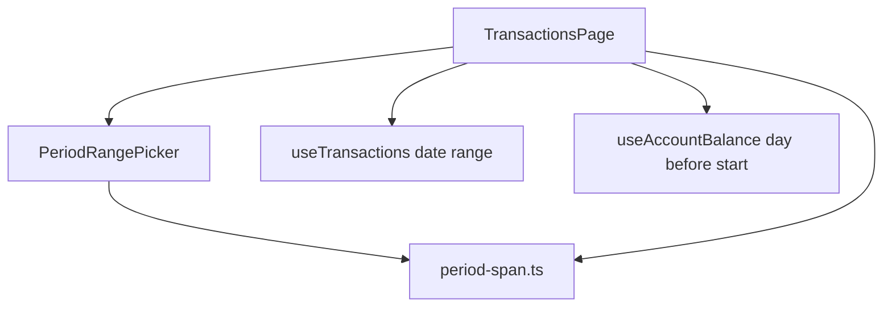

# Transaction Period Filter Design

**Spec**: `.specs/features/transaction-period-filter/spec.md`
**Status**: Approved

---

## Architecture Overview

The span is a pure value. The popover edits it. The Transactions page already knows how to list a `from`/`to` range and how to walk a running balance. This feature adds the value, the control, and the wiring. It does not add a table, a query, or a stored period.



`today` is an argument. Shortcut math does not call `new Date()` itself. ISO dates are built from year, month, and day numbers. `toISOString()` is not used.

---

## Code Reuse Analysis

### Existing Components to Leverage

| Component | Location | How to Use |
| --- | --- | --- |
| Month range query | `src/ui/hooks/useTransactions.ts` | Pass `{ from, to }` for the inclusive span. The hook already refetches on those strings |
| Running balance date | `src/ui/hooks/useAccountBalance.ts` | Pass the ISO day before the start month. `calculateBalance` is inclusive of that date |
| Page list and balance walk | `src/ui/pages/TransactionsPage.tsx` | Keep the sort, the credit/debit walk, and the all-accounts column rules. Replace only the period state and the stepper |
| Domain style | `src/domain/account-import-period.ts` | Pure functions, readonly types, no clock inside the function |
| Component tests | `src/ui/components/Sidebar.test.ts` | Vitest, `@vitest-environment jsdom`, Testing Library, `createElement` |
| Toolbar styling | `TransactionsPage` account `<select>` | `border-mtt-border`, `rounded-lg`, `bg-mtt-surface`, `text-sm`, `focus:ring-mtt-accent` |

### Integration Points

| System | Integration Method |
| --- | --- |
| Transactions route | Same page. No new route |
| SQLite | Existing `transaction_date >= from AND transaction_date <= to` |
| Dashboard and import period fields | Untouched |

---

## Components

### period-span

- **Purpose**: Turn a calendar-month span into dates, labels, and shortcut spans.
- **Location**: `src/domain/period-span.ts`
- **Interfaces**:
  - `CalendarMonth` — `{ year: number; month: number }` with `month` in 1–12
  - `MonthSpan` — `{ start: CalendarMonth; end: CalendarMonth }`
  - `PeriodShortcut` — `'this-month' | 'last-3-months' | 'this-year' | 'last-12-months'`
  - `currentCalendarMonth(today: Date): CalendarMonth` — local calendar year and month of `today`
  - `monthSpanForShortcut(today: CalendarMonth, shortcut: PeriodShortcut): MonthSpan` — windows that end on `today`. On `{ year: 2026, month: 11 }`, last 3 is Sep–Nov 2026, this year is Jan–Nov 2026, last 12 is Dec 2025–Nov 2026
  - `inclusiveDateRange(span: MonthSpan): { from: string; to: string }` — `YYYY-MM-DD` from the first day of `start` through the real last day of `end`
  - `dayBeforeSpan(span: MonthSpan): string` — ISO date of the last calendar day before `start`
  - `formatSpanLabel(span: MonthSpan): string` — `Nov 2026`, or `Dec 2025 – Nov 2026` with a space, U+2013, space
  - `compareMonths(a: CalendarMonth, b: CalendarMonth): number` — negative when `a` is earlier
  - `shiftYear(month: CalendarMonth, delta: number): CalendarMonth` — same month, year plus `delta`, no clamp
- **Dependencies**: none
- **Reuses**: the pure-function shape of `account-import-period.ts`

### PeriodRangePicker

- **Purpose**: The toolbar button and the popover that edit a `MonthSpan`.
- **Location**: `src/ui/components/PeriodRangePicker.tsx`
- **Interfaces**:
  - Props: `span: MonthSpan`, `today: CalendarMonth`, `onChange: (span: MonthSpan) => void`
  - Button accessible name `Period`. Closed label is `formatSpanLabel(span)`
  - Popover shortcuts use the visible names This month, Last 3 months, This year, Last 12 months. Each calls `onChange(monthSpanForShortcut(today, shortcut))` and closes
  - Two grids, headings From and To. Each shows Jan–Dec for one year, with Previous year and Next year. From opens on `span.start.year`. To opens on `span.end.year`
  - Month button accessible name is the en-US long month and year, for example `November 2026`. Visible text is the short month
  - Local state: `open`, `pendingStart: CalendarMonth | null`, `fromYear`, `toYear`
  - First click on either grid sets `pendingStart` and does not call `onChange`
  - A later From click replaces `pendingStart`
  - A later To click on or after `pendingStart` calls `onChange` with that span and closes
  - A later To click before `pendingStart` replaces `pendingStart`
  - The same month as start and end calls `onChange` with that single month and closes
  - Escape or pointerdown outside discards `pendingStart` and does not call `onChange`
  - While a start is pending, months from that start through the hovered To month are highlighted. Hover does not call `onChange`
  - Below the `sm` breakpoint the grids stack in one column
  - On close, focus returns to the Period button
- **Dependencies**: `period-span.ts`, React
- **Reuses**: toolbar classes on the Transactions page. No date-picker library

### TransactionsPage wiring

- **Purpose**: Hold the applied span and feed the existing list and balance.
- **Location**: `src/ui/pages/TransactionsPage.tsx`
- **Interfaces**:
  - State is a `MonthSpan`, initialized with `currentCalendarMonth(new Date())` as both start and end
  - `useTransactions` receives `inclusiveDateRange(span)`
  - `useAccountBalance` receives `dayBeforeSpan(span)`
  - Empty copy is `No transactions for ${formatSpanLabel(span)}.`
  - The account `<select>` stays. Changing it does not reset the span
  - The Previous month and Next month buttons are removed
  - Leaving the page drops the state, so a return opens on the current month
- **Dependencies**: `PeriodRangePicker`, `period-span.ts`, existing hooks
- **Reuses**: the current sort, running-balance walk, and all-accounts column rules

---

## Data Models

### CalendarMonth

```typescript
type CalendarMonth = Readonly<{
  year: number;
  month: number; // 1–12
}>;
```

### MonthSpan

```typescript
type MonthSpan = Readonly<{
  start: CalendarMonth;
  end: CalendarMonth;
}>;
```

**Relationships**: A span is view state on the Transactions page. It is not a table and it is not synced. `inclusiveDateRange` is the only value the repository sees, as the existing `{ from, to }` strings.

---

## Error Handling Strategy

| Error Scenario | Handling | User Impact |
| --- | --- | --- |
| End month clicked before the start | The click becomes the new start. `onChange` is not called | The list stays on the applied span. The popover stays open |
| Popover dismissed before a range is complete | Drop `pendingStart`. Do not call `onChange` | The applied span stays |
| Future month with no rows | The query returns an empty list | Empty state names that month |
| February in a leap year and a common year | `inclusiveDateRange` uses the real last day | 2024-02-29 is included. 2025-02-28 is the last day of February 2025 |

There is no invalid stored span. The control only emits `start <= end`.

---

## Risks & Concerns

| Concern | Location (file:line) | Impact | Mitigation |
| --- | --- | --- | --- |
| Balance date uses `toISOString()`, which is UTC | `src/ui/pages/TransactionsPage.tsx:43` | East of UTC, local midnight on the last day of the previous month can format as the day before | T3 passes `dayBeforeSpan`, built from calendar parts |
| The page component owns the filter, the form, and the table | `src/ui/pages/TransactionsPage.tsx:137` | A span change can get tangled with edit and delete state | The picker is a separate component. The table, form, and sort stay as they are |
| E2E locks the month stepper | `e2e/transactions.spec.ts:134` | `month navigation changes displayed period` fails when the arrows are removed | T3 replaces that test with the span control |
| A long span renders every row | `src/ui/pages/TransactionsPage.tsx:251` | A busy year is a long scroll | Accepted in the spec. The query is already bounded by `from` and `to`. No paging in this feature |
| UI files are outside the coverage include | `vitest.config.ts:10` | A green coverage run does not prove the picker | T2 still has a jsdom test per picker behavior. Domain coverage stays on `period-span.ts` |

---

## Tech Decisions

| Decision | Choice | Rationale |
| --- | --- | --- |
| Hover preview | Highlight from the pending start through the To month under the pointer | Agent discretion. It shows the span before the second click commits it |
| Narrow layout | Grids stack below the `sm` breakpoint | Agent discretion. Two year grids do not fit a phone toolbar popover side by side |
| Focus | Return focus to the Period button on close | Agent discretion. The button is the control that opened the popover |
| Clock | `today` is passed in | Shortcut tests fix the date at 2026-11-02 without stubbing the system clock |
| Popover | A positioned div, Escape, and pointerdown outside | The app has no date-picker or popover library |
